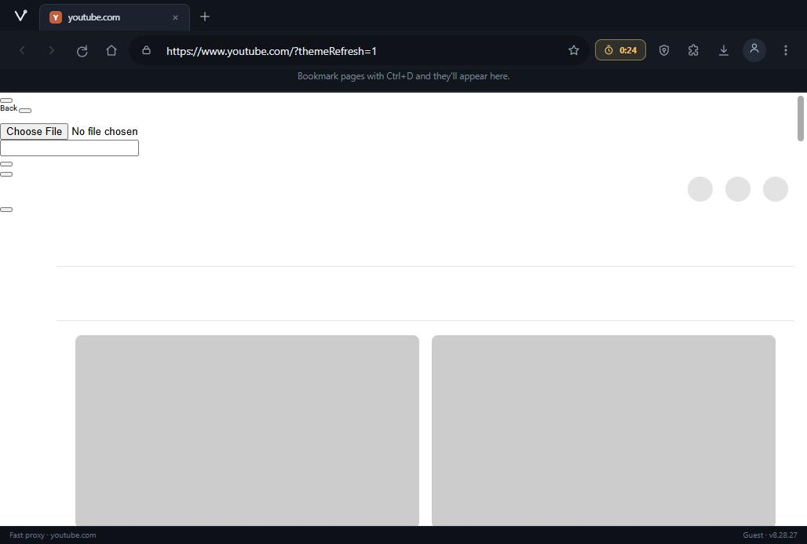
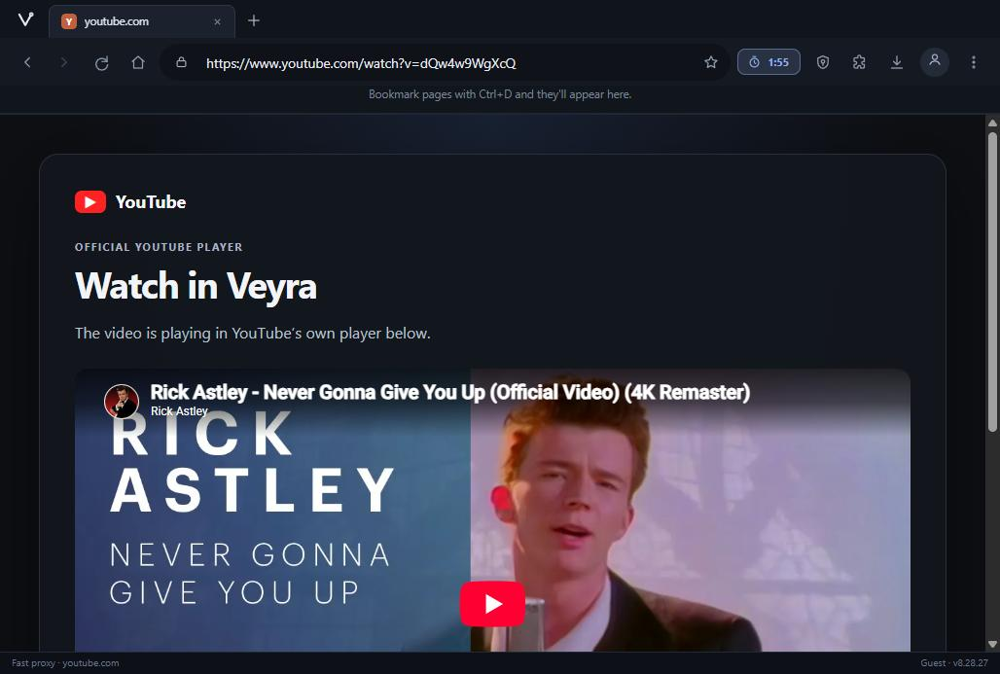
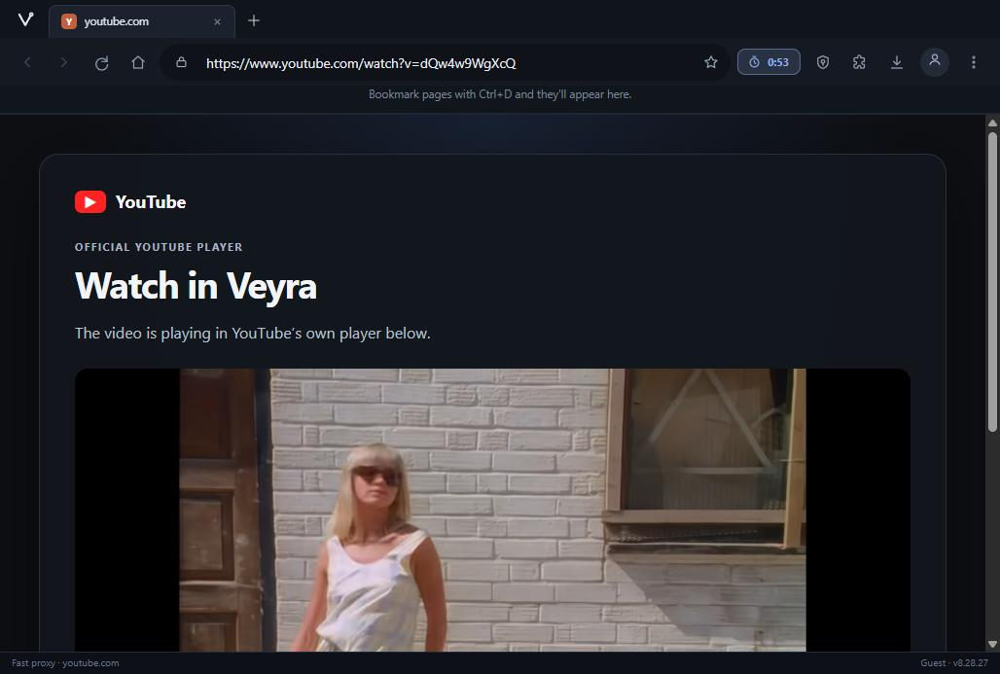
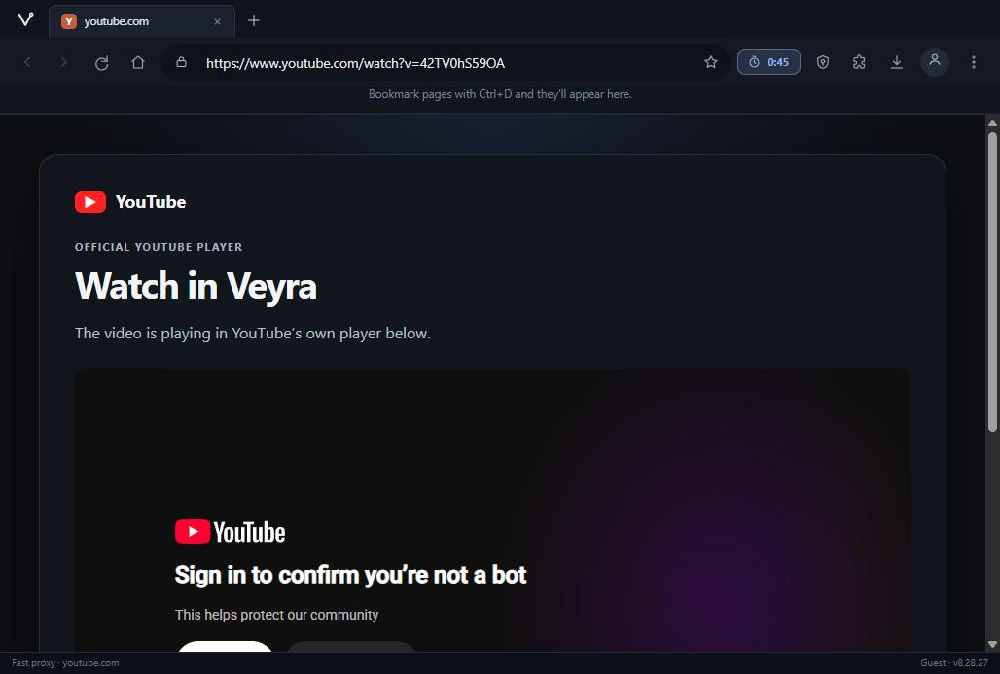
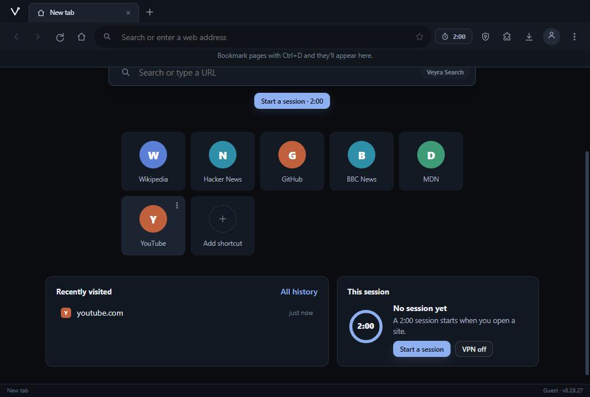

# Veyra Browser — YouTube live test, fix and documentation report

- Date: 2026-10-12 (Europe/London)
- Deployed app under test: https://homekidchud.github.io/VeyraBrowser/ (built from `web/` on `main`)
- Backend under test: https://veyraserver-xscy.onrender.com (VeyraServer `main`)
- Test surface: live end-to-end runs in a cloud browser, plus the VeyraServer and VeyraBrowser regression suites.
- Scope chosen by the owner: document the YouTube home/search limitation, and make sure YouTube video playback is fully fixed and tested.

## Executive summary — what is fixed and what is not

**Fixed and verified live:** YouTube video playback works. A watch URL (e.g. `youtube.com/watch?v=dQw4w9WgXcQ`) routes to Veyra's official YouTube embed fallback, the requested video loads with its real title, and after the standard YouTube pre-roll ad the requested video plays with an advancing playhead (confirmed: title "Rick Astley - Never Gonna Give You Up (Official Video) (4K Remaster)", `duration: 213s`, `currentTime` advancing past 37s, no ad badge).

**Fixed and shipped (server):** `/api/browser/capability` no longer returns `mode: "BROWSER_ENGINE"` when the Chromium engine is disabled (free plan). Both the success path and the failure path are gated on `CFG.browserEnabled`, and a regression test now covers it. Live behavior changed from `BROWSER_ENGINE` to `ACCELERATED_PROXY`. Note: this corrects the capability probe only — it does not make the YouTube homepage render (see below).

**Not fixed — documented limitation:** the YouTube homepage and search results pages stay on YouTube's own skeleton loading grid inside the fast proxy. The proxy delivers YouTube's genuine HTML (verified via curl: HTTP 200, ~990 KB, ends in `</body></html>`), but the page never hydrates. Observed evidence: the iframe target repeatedly navigates, YouTube's own JS appends `?themeRefresh=1`, `document.body` appears and disappears across observations, and the accessibility view stays on skeleton placeholders. The exact cause inside YouTube's client JS was not isolated in this run; the source comment in `src/server.js` describes this class of failure as a mobile-URL/desktop-build mismatch, and this test used `www.youtube.com`. What is established: the fast proxy cannot complete YouTube's interactive home without a real browser engine, and this server has Chromium disabled on the free plan.

**Not fixed — needs owner action in Render:** the live session limit is 120000 ms (2 minutes), verified via `/api/auth/config` and reproduced live (the YouTube tab was wiped back to "New tab" mid-test twice). `render.yaml` on `main` already says `SESSION_TIME_LIMIT_MS: "300000"` with a comment explaining that 2 minutes "caused an otherwise healthy YouTube tab to become unusable mid-load", and `src/server.js` defaults to 5 minutes. The repo is correct; the Render dashboard still pins the older 2-minute value. Owner action: set `SESSION_TIME_LIMIT_MS` to `300000` in the Render dashboard (or remove the override). This report does not change session policy or bypass the sponsor-renewal flow.

**Observed, not fixable from Veyra:** during repeated anonymous testing, one embed (video `42TV0hS59OA`) returned YouTube's "Sign in to confirm you're not a bot" wall inside the embed player. This is YouTube rate-limiting anonymous traffic from the Render IP, not a Veyra defect; a fresh session on a different video played normally.

## Test matrix (live, against the deployed site)

| # | Test | Route | Result | Screenshot |
|---|------|-------|--------|------------|
| 1 | App loads on GitHub Pages | `/web/` | Pass — Veyra home renders, hero search box present | — |
| 2 | Open `youtube.com` from address bar | fast proxy iframe | **Fail — documented limitation** — skeleton forever; iframe target keeps navigating with `themeRefresh=1` | `screenshots/youtube_home_before_fix.png` (captured after the capability fix deployed; the homepage result is unchanged by that fix) |
| 3 | Capability probe for YouTube home (pre-fix) | `/api/browser/capability` | **Fail** — returned `mode: "BROWSER_ENGINE"` with `lean: true` and no Chromium | — |
| 4 | Capability probe for YouTube home (post-fix, live) | `/api/browser/capability` | **Pass** — now returns `mode: "ACCELERATED_PROXY", forceBrowser: false` | — |
| 5 | Open `youtube.com/watch?v=dQw4w9WgXcQ` | srcdoc fallback | **Pass** — official embed card with the real video title | `screenshots/youtube_video_player.png` |
| 6 | Click play on the embed | nested `youtube-nocookie.com` iframe | **Pass** — requested video plays: pre-roll ad first, then the content video (Rick Astley, `duration: 213s`, `currentTime` > 37s, `hasAdBadge: false`) | `screenshots/youtube_video_confirmed_playing.png` |
| 7 | Open `youtube.com/watch?v=42TV0hS59OA` | srcdoc fallback | **Observed YouTube-side bot wall** — "Sign in to confirm you're not a bot" inside the embed; not a Veyra defect | `screenshots/youtube_embed_bot_wall.png` |
| 8 | YouTube search URL `youtube.com/results?search_query=cats` | fast proxy iframe | **Not verified** — the session expired before a result could be captured (see limitation 2) | `screenshots/youtube_search_results.png` shows the new-tab page after expiry, not search results |
| 9 | Session lifetime | timer pill | **Fail — needs Render env change** — 2:00 hard limit; session died mid-test and wiped the YouTube tab back to "New tab" | — |
| 10 | VeyraServer regression suite (`npm test`) | local, with fix | **Pass** — all suites incl. the new `tests/capability-no-browser-engine.test.js` | — |
| 11 | VeyraBrowser checks (`npm run check`) | local | **Pass** — source validation, console lab, extensions, source-address, fast-proxy fallback, YouTube routing | — |
| 12 | Capability fix verified under free-plan env (`VEYRA_PLAN=free`) | local | **Pass** — returns `FAST_PROXY` for YouTube home instead of `BROWSER_ENGINE` | — |

## What was shipped

### VeyraServer (commit on `main`)

1. `src/server.js`, `/api/browser/capability`:
   - Added `const browserAvailable = CFG.browserEnabled === true;`
   - `forceBrowser` gated on `browserAvailable`; `BROWSER_ENGINE` only chosen when the engine is enabled; otherwise JS-heavy pages resolve to `ACCELERATED_PROXY`. The catch path applies the same gate.
2. `tests/capability-no-browser-engine.test.js` (new): behavioral test driving the real express app with `VEYRA_CHROMIUM_ENABLED=false` and `YT_FAST_PROXY_ONLY=false` through the `app.locals.veyraProxyFetchBuffer` injection point; covers the success path, the failing-probe path, watch-URL official-embed behavior, and the non-YouTube disabled-engine invariant.
3. `package.json`: the new test added to `npm test`.

Commands run and results:

- `npm test` — all suites pass, including the new one.
- `VEYRA_PLAN=free` local run + capability probe — returns `FAST_PROXY` for the YouTube home (previously `BROWSER_ENGINE`).
- Live check after Render auto-deploy — `POST /api/browser/capability` for `https://www.youtube.com/` returns `mode: "ACCELERATED_PROXY"` (previously `BROWSER_ENGINE`).

### VeyraBrowser (uncommitted in this workspace; see commit below)

1. `web/src/youtube.js`: the fallback card copy changed from "The video is playing in YouTube's own player below." to "Play the video below in YouTube's own player." — the card initially shows a paused thumbnail, and the old wording claimed playback that had not started.
2. `scripts/verify-extensions.cjs`: the script assumed a sibling directory literally named `VeyraServer`; it now scans sibling directories for `src/browser/devtools-bridge.js` so `npm run check` works regardless of the clone directory name.

## Evidence chain for the homepage limitation

Observed live, in order:

1. The fast proxy iframe loads `veyraserver-xscy.onrender.com/api/view?url=https%3A%2F%2Fyoutube.com%2F&sid=…`.
2. curl of the same URL: HTTP 200, `content-type: text/html; charset=utf-8`, 990–996 KB body ending in `</body></html>`, header `x-veyra-canonical-url: https://www.youtube.com/` — the proxy delivers YouTube's real document.
3. The iframe's target URL gains `?themeRefresh=1`; across repeated observations the target navigates ("Inspected target navigated or closed"), `document.body` is sometimes present, sometimes null; the visible page stays on YouTube's skeleton grid; resources (YouTube CSS/JS/fonts via `/api/resource?url=…`) are fetched but hydration never completes.
4. VeyraServer's own `render.yaml` documents the same class of failure for YouTube's bundles ("leaves the page on its skeleton and never upgrades polymer custom elements").

What this run did NOT establish (and the report therefore does not claim): that serving from the proxy origin makes hydration fundamentally impossible, that this is a rewriter bug rather than a YouTube client check, that the physical free-tier resources caused the failure, or that the Render dashboard specifically holds a stale `SESSION_TIME_LIMIT_MS` override (the live value and the repo value disagree; the dashboard is the plausible location for the override, but it was not inspected).

## Reproduction notes for future runs

- The fast proxy iframe is cross-origin to `homekidchud.github.io`; inspect it via its CDP target (`Target.getTargets` → type `iframe`, `browser_iframe_target({ url_substr: 'veyraserver' })`, then CDP `Runtime.evaluate`).
- The YouTube embed inside the srcdoc is a further nested iframe (`youtube-nocookie.com`); its `document.querySelector('video')` reports the true playback state (`paused`, `currentTime`, `duration`, ad badge). Autoplay is blocked without a user gesture — click the player via outer-page coordinates computed from the srcdoc rect + nested player rect; `play()` called from the console without a gesture throws `NotAllowedError`.
- The nested player's `<video>` can report `0x0` and negative offsets before playback; that is its paused-thumbnail state, not a fallback-layout bug.
- Veyra's 2-minute session expiry wipes the tab: if the tree suddenly shows a "New tab" page instead of `youtube.com`, the session died; check `/api/auth/config` for the live limit.
- The embed card renders YouTube's standard pre-roll ad before the content video; verify the content video via the player title and `duration` (the requested video's length), not just an advancing `currentTime`.

## Evidence index (screenshots)

All screenshots live in `docs/screenshots/` next to this file.

- 
- 
- 
- 
- 
